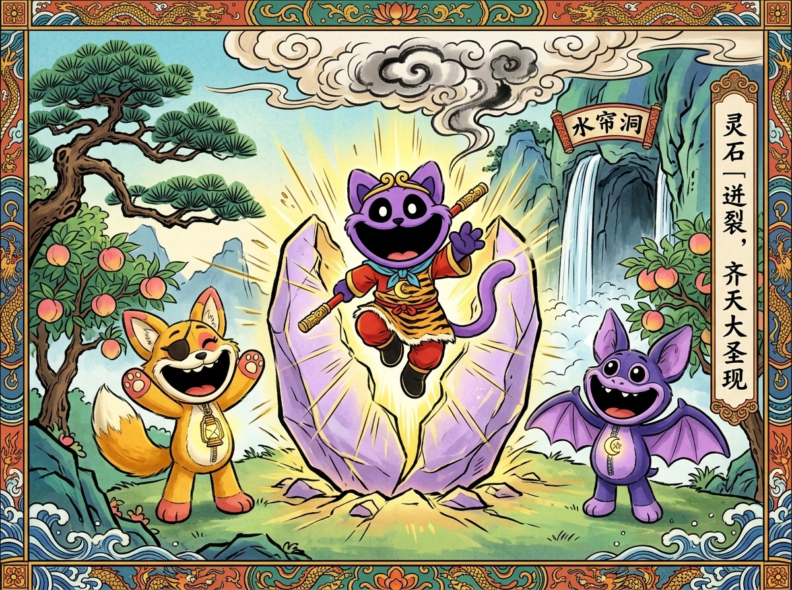
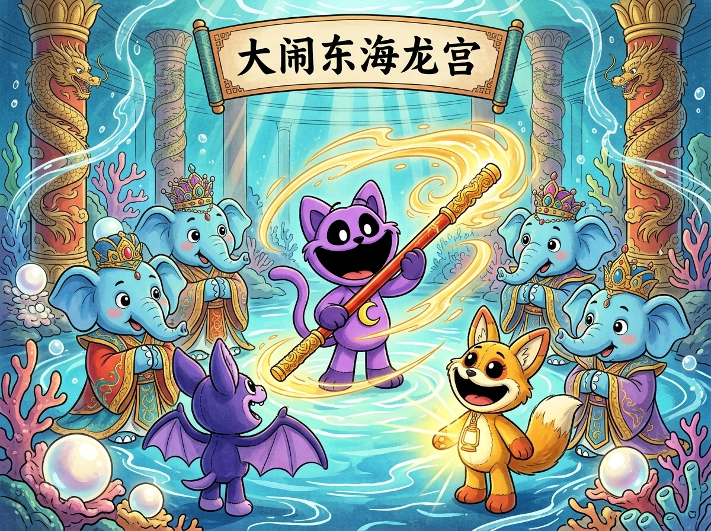
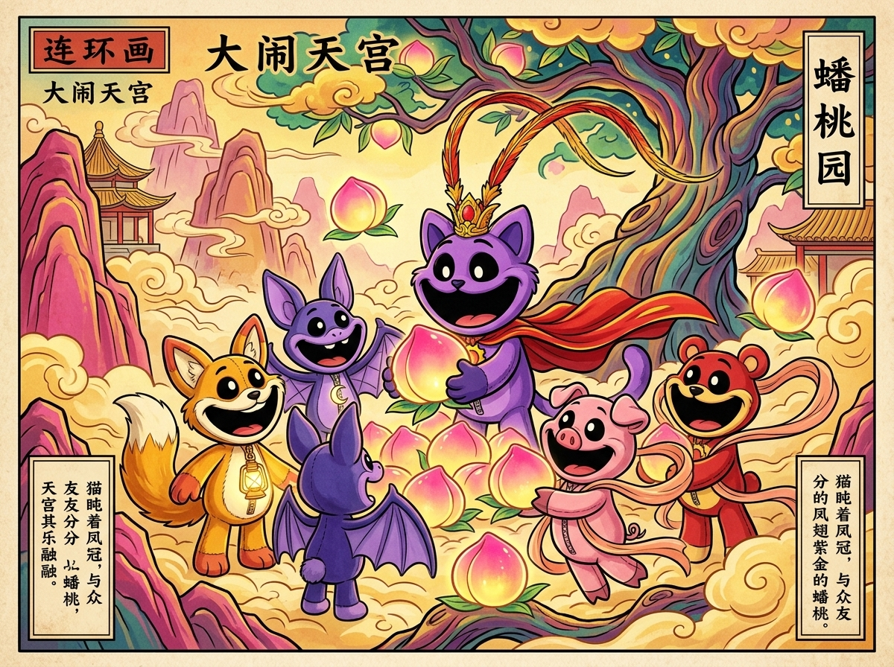
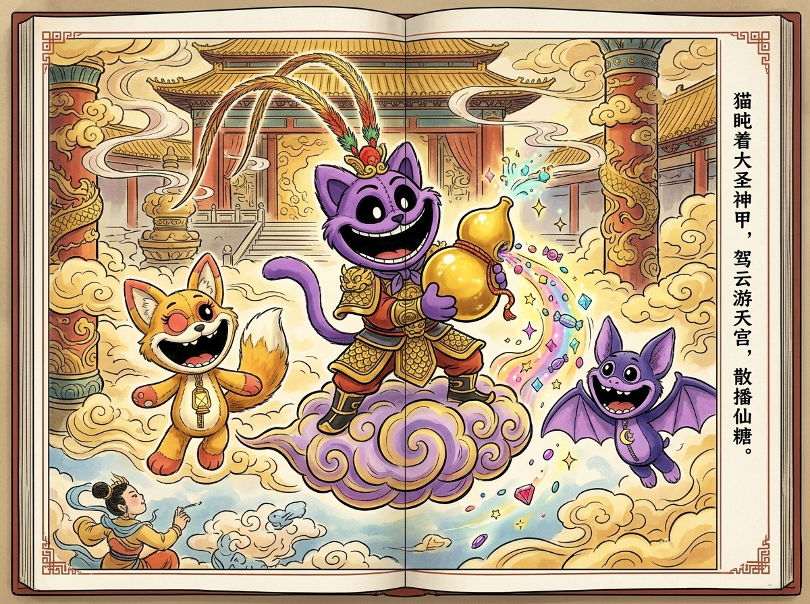
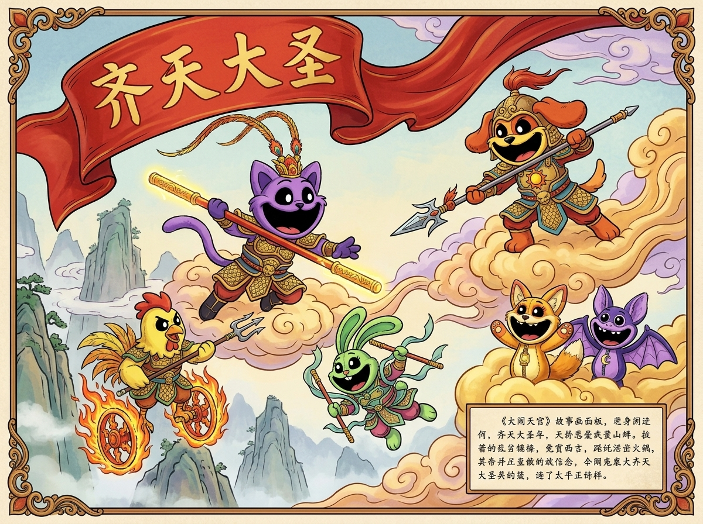
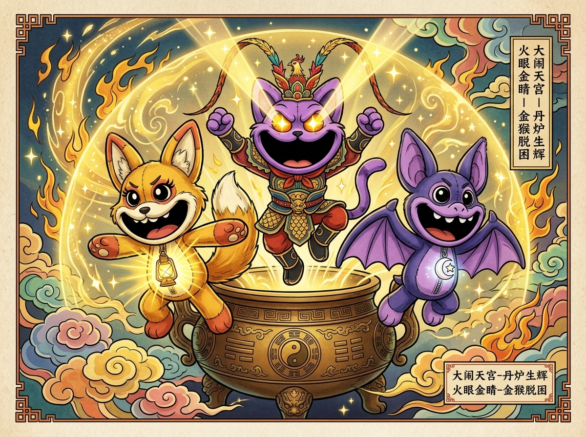
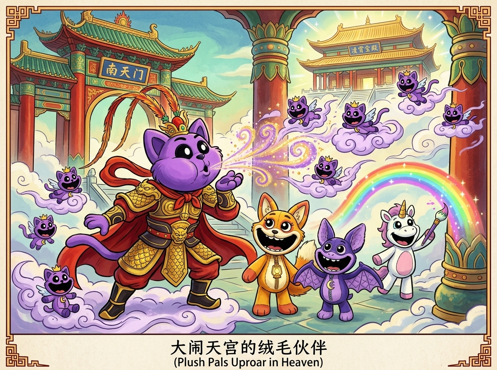
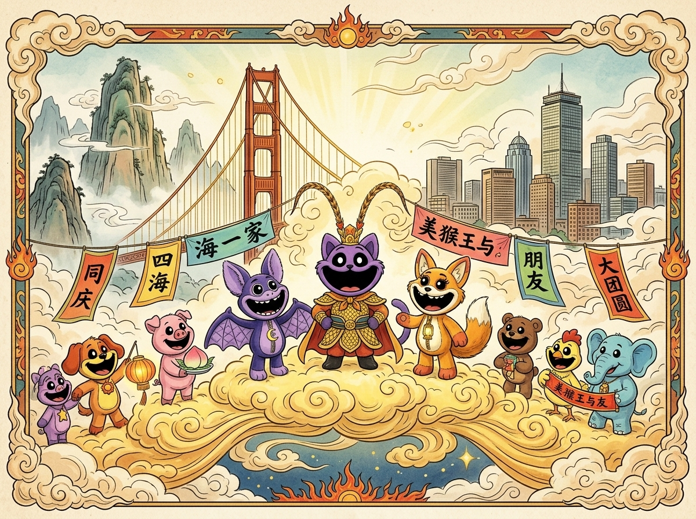

# 📖🌙🦊🦇 Smiling Critters: Havoc in Heaven — Interactive Lianhuanhua Picture Book (微笑萌兽大闹天宫 · 八回连环画)

> **Classic Chinese *Havoc in Heaven* (孙悟空大闹天宫) Adapted for CatNap, Mom's Custom SunnyFox & LunaBat, and the Smiling Critters!**

### 🚀 [**Read & Play the Interactive Lianhuanhua Book on iPad / Browser → https://kunruiw1991.github.io/critters-havoc-in-heaven/**](https://kunruiw1991.github.io/critters-havoc-in-heaven/)

---

## 🌟 Cast of Characters (角色谱)

- **🌙 CatNap — The Starlight Monkey King (齐天大圣·紫月喵王)**: Born from a glowing lavender moon-stone on Flower-Fruit Mountain, wearing the Phoenix-Feather Golden Crown (`凤翅紫金冠`), Golden Chainmail Armor (`锁子黄金甲`), and wielding the Moon-Crest Golden Staff (`如意金箍棒`).
- **🦊🏮 SunnyFox (LanternFox — Mom's Custom Creation)**: Guides the adventure with her glowing **Golden Storm-Lantern Chest Pendant**, lighting up the underwater Eastern Sea Dragon Palace and weaving a protective golden starlight shield inside the Eight-Trigrams Furnace!
- **🦇🌙 LunaBat (StarBat — Mom's Custom Creation)**: Soars through the clouds on her **diamond-quilted lavender bat wings** with her glowing **Crescent Moon & Starburst Pendant**.
- **🐘👑 Bubba Bubbaphant**: Dragon King of the Eastern Sea Crystal Palace.
- **🐷🍑 PickyPiggy & 🐻 Bobby BearHug**: Guardians of the Celestial Immortal Peach Orchard.
- **🐶☀️ DogDay, 🐔🔥 KickinChicken & 🐰 Hoppy Hopscotch**: Celestial Generals in the Great Sky Tournament.
- **🦄🌈 CraftyCorn**: Celestial Rainbow Weaver at the Southern Heaven Gate.

---

## 🖼️ Complete 8-Chapter Lianhuanhua Gallery (八回连环画全图)

| Chapter | Illustration | Title & Story Summary |
| :---: | :---: | :--- |
| **第一回** Ch. 1 |  | **花果山仙石孕紫月 · 水帘洞群萌拜大圣** *Birth of the Starlight Critter King on Flower-Fruit Mountain* |
| **第二回** Ch. 2 |  | **探龙宫喜得金箍棒 · 宝灯照亮水晶宫** *The Magical Golden Staff of the Eastern Sea Dragon Palace* |
| **第三回** Ch. 3 |  | **掌蟠桃仙园尝仙果 · 众好友同享瑶池甜** *The Great Immortal Peach Orchard Feast* |
| **第四回** Ch. 4 |  | **兜率宫巧取星光糖 · 紫雾筋斗云游九霄** *The Golden Gourd of Starlight Candies & Somersault Cloud* |
| **第五回** Ch. 5 |  | **竖大旗号称齐天圣 · 云端比武会众神将** *The Great Sage Sky Tournament Above Flower-Fruit Mountain* |
| **第六回** Ch. 6 |  | **八卦炉金灯护良朋 · 炼就火眼金睛破炉出** *SunnyFox's Lantern & LunaBat's Moon Shield in the Eight-Trigrams Furnace* |
| **第七回** Ch. 7 |  | **拔毫毛变出百萌喵 · 凌霄殿前绘彩虹桥** *Magic Fur Clones & Rainbow Bridge at the Southern Heaven Gate* |
| **第八回** Ch. 8 |  | **金门大桥连波士顿 · 四海一家蟠桃大团圆** *Grand Finale: The Golden Cloud Bridge from San Francisco to Boston* |
